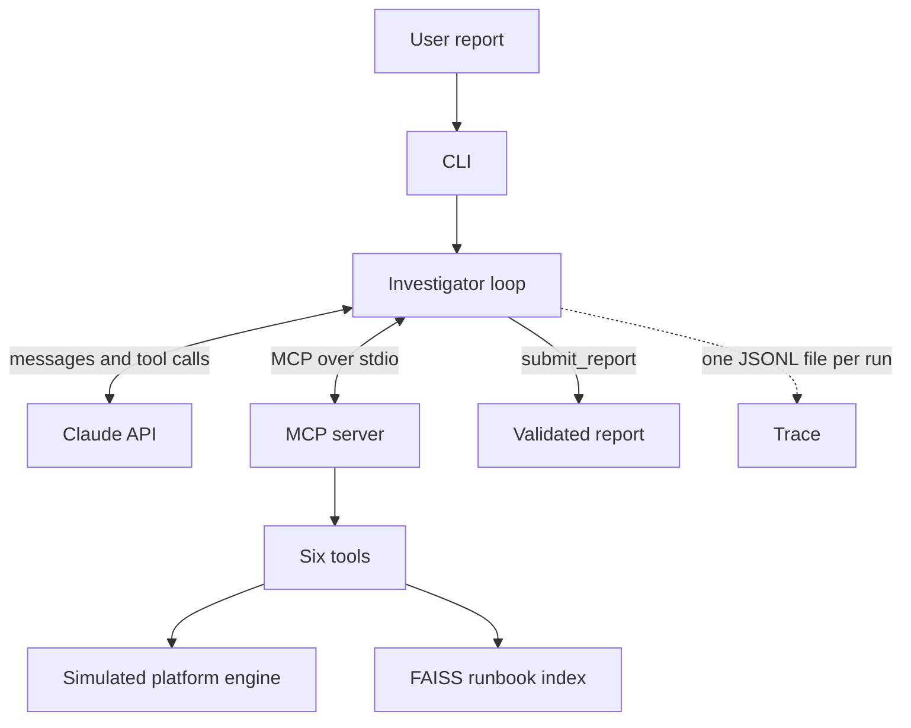

# RootSignalAgent

RootSignalAgent is an MCP-based incident triage agent for a simulated data platform. A user reports a failed job; the agent investigates through tools and returns a structured, evidence-backed report with a dry-run remediation proposal.

It never executes a remediation. Every proposal is a description of what a human could approve.

## How it works



1. The CLI takes the user's report and starts an `Investigator`.
2. The Investigator launches the MCP server as a child process and talks to it over stdio.
3. Each turn, the Claude API is given the report, the conversation so far, the server's tools and a local `submit_report` tool.
4. When the model asks for a tool call, the Investigator forwards it to the MCP server, redacts and truncates the result, and appends it to the conversation.
5. The loop ends when the model calls `submit_report` and the report passes validation. If the tool-call budget or the time limit runs out first, the loop forces a submission.
6. Every model response, tool call and tool result is written to a JSONL trace as it happens.

## Tools

| Tool | What it does |
| --- | --- |
| `get_job_status` | Current state of a job: status, times, attempt number, last success, exit reason. |
| `search_logs` | Recent log lines for a job, filtered by level and a substring query. |
| `query_metric` | A metric time series for a job over a recent window. |
| `search_runbooks` | Retrieves up to 3 candidate runbooks from the FAISS index for a symptom description. |
| `list_recent_incidents` | A team's recent incidents, for when the user does not name a job. |
| `propose_remediation` | Describes a remediation from a fixed allowlist as a dry run. Nothing is executed. |

## Design decisions

- **Read-only tools, dry-run-only remediation.** `propose_remediation` accepts only actions on an allowlist and only describes them. No code path executes a remediation.
- **Structured report.** The model submits its answer through a local `submit_report` tool, and the loop validates it with pydantic. Each piece of evidence is a quote from a tool result plus why it matters.
- **Evidence-first runbook search.** The tool description tells the model to search with symptoms observed in logs and metrics, not just the user's wording. This matters; see the retrieval numbers under Results.
- **Secret redaction twice.** Tool results are redacted at the MCP server, and again in the loop before they reach the model or the trace.
- **Limits.** A tool-call budget, per-tool and overall timeouts, and forced submission when the budget or time runs low.
- **Child process isolation.** The MCP server child runs with secret-looking variables stripped from its environment, so it never sees the API key.
- **JSONL traces.** One file per run, written event by event.
- **294 tests**, using a scripted fake LLM so the agent loop is tested without API calls.

## Quickstart

Requires Python 3.11+, [uv](https://docs.astral.sh/uv/), and an Anthropic API key.

```bash
uv sync
cp .env.example .env
# edit .env: set ANTHROPIC_API_KEY and ROOTSIGNAL_AGENT_MODEL=claude-haiku-5-5

uv run python -m rootsignal_agent.sim --list           # list the 10 scenarios
uv run python -m rootsignal_agent.cli --scenario oom_01
uv run python -m rootsignal_agent.cli --all
```

The last two commands make real API calls and cost money. Run the tests, which make no API calls, with:

```bash
uv run pytest
```

## Example output

Abridged and reformatted from a real run on `oom_01` (Claude Haiku 5.5).

```text
Root cause: oom (confidence: high)
daily_orders failed on all 3 attempts because executors ran out of Java heap
during the transform_orders aggregation; YARN killed the container with exit
code 137.

Evidence
  search_logs   "java.lang.OutOfMemoryError: Java heap space"
  search_logs   "Container killed by YARN for exceeding physical memory limits.
                 7.2 GB of 7 GB physical memory used on worker-07.dp.internal"
  query_metric  {"ts": "2026-10-15T02:10:00", "value": 0.9836}
                (executor heap utilization jumped from ~0.54 to ~0.98)

Alternatives considered: data_skew, resource_starvation, disk_full
Runbook: oom.md
Proposed remediation (dry run): increase_memory

7 tool calls | 49138 in / 2654 out tokens
```

## Results

### Runbook retrieval

Measured over the 10 scenarios.

| Query | hit@1 | hit@3 |
| --- | --- | --- |
| User report alone | 20% | 60% |
| User report plus one log line | 70% | 100% |

### Live development run

Claude Haiku 5.5, one run per scenario. This is a development run, not a held-out evaluation.

| Scenario | Predicted category | Runbook | Proposed action | Correct (category/runbook/action) |
| --- | --- | --- | --- | --- |
| auth_expired_01 | auth_expired | auth_expired.md | escalate_to_oncall | Y/Y/Y |
| disk_full_01 | disk_full | disk_full.md | clear_scratch_space | Y/Y/Y |
| misleading_auth_01 | auth_expired | auth_expired.md | escalate_to_oncall | Y/Y/Y |
| misleading_upstream_01 | upstream_late | upstream_late.md | rerun_with_backoff | Y/Y/Y |
| network_timeout_01 | network_timeout | network_timeout.md | rerun_with_backoff | Y/Y/N |
| oom_01 | oom | oom.md | increase_memory | Y/Y/Y |
| schema_change_01 | schema_change | schema_change.md | escalate_to_oncall | Y/Y/Y |
| skew_01 | data_skew | data_skew.md | escalate_to_oncall | Y/Y/Y |
| starvation_01 | resource_starvation | resource_starvation.md | rerun_with_backoff | Y/Y/Y |
| upstream_late_01 | upstream_late | upstream_late.md | restart_job | Y/Y/N |

Category 10/10, runbook 10/10, action 8/10. Total estimated cost was $0.059, about $0.006 per investigation.

The two action mismatches are defensible alternatives. The reference action for `network_timeout_01` was `restart_job`, and for `upstream_late_01` it was `rerun_with_backoff`.

## Limitations

- The platform is simulated. There is no real Airflow or Spark behind it.
- The 10 scenarios were written by the author and used during development, so the results above are not a held-out evaluation.
- Each scenario was run once, and model output is non-deterministic.
- Tested only on Claude Haiku 5.5.
- The prompt requires evidence quotes, but code does not yet verify that they appear in the tool results.
- Confidence is uncalibrated; it is almost always "high".

## Status and roadmap

Done:

- Platform simulator with 10 incident scenarios
- Runbooks and FAISS retrieval
- MCP server with six tools
- Agent loop with structured reports and traces
- CLI

Planned, not built:

- Evidence-quote verification
- Slack bot
- Evaluation harness with a larger scenario set and prompt/model variants
- Prometheus/Grafana dashboard
- Go node probe
